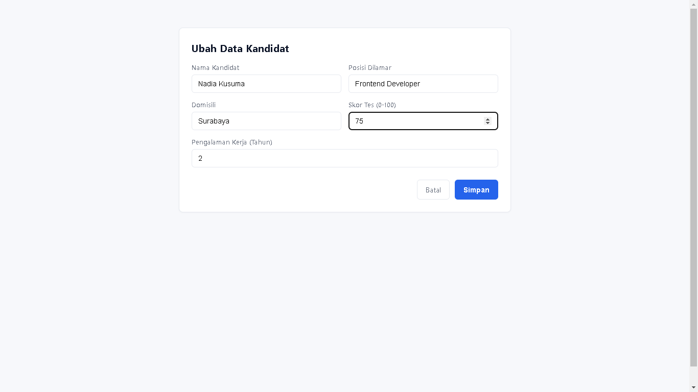
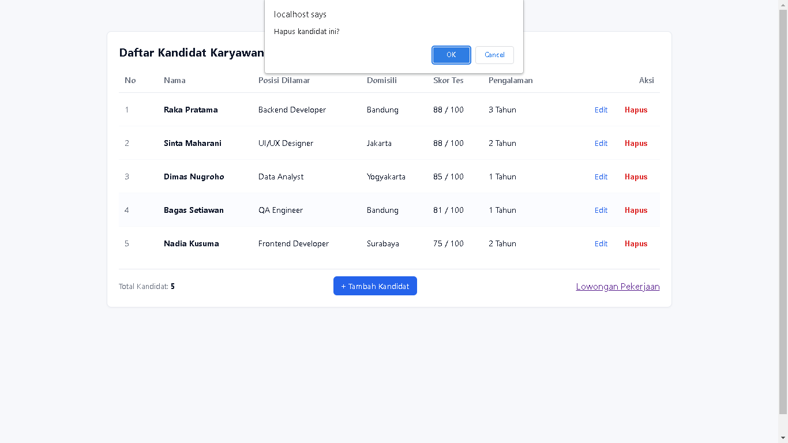
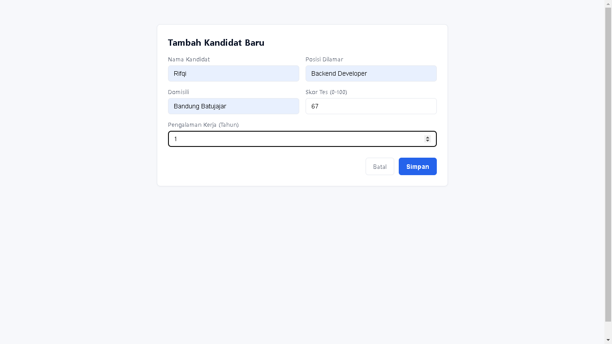
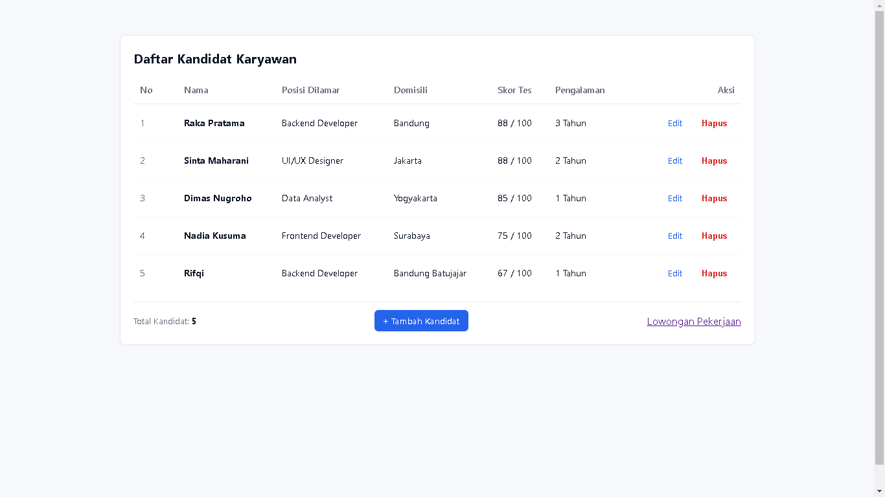
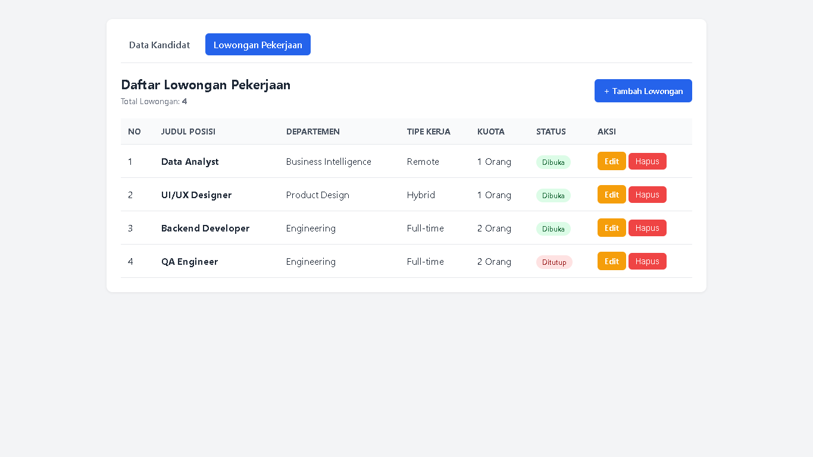
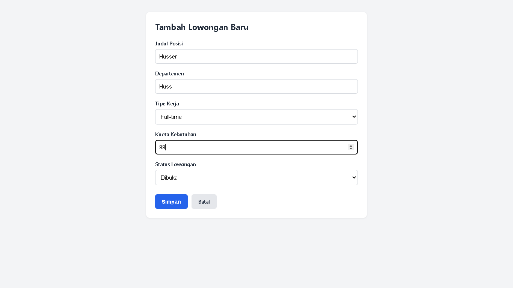
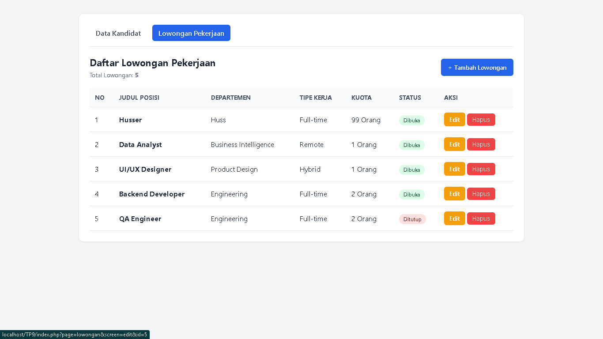

# TP9DPBO2526C1
## JANJI
Saya Louis Marcel Wendy Adrianto dengan NIM 2509068 mengerjakan Tugas Praktikum 9 pada Mata Kuliah Desain dan Pemrograman Berorientasi Objek (DPBO) untuk keberkahan-Nya maka saya tidak melakukan kecurangan seperti yang telah dispesifikasikan. Aamiin

## STRUKTUR MVP DAN PENJELASAN
```
MVP_Kandidat/
├── index.php
├── mvp_db.sql
├── models/
│   ├── DB.php
│   ├── Kandidat.php
│   ├── KontrakModel.php
│   ├── TabelKandidat.php
│   ├── Lowongan.php
│   ├── KontrakModelLowongan.php
│   └── TabelLowongan.php
├── presenters/
│   ├── KontrakPresenter.php
│   ├── PresenterKandidat.php
│   ├── KontrakPresenterLowongan.php
│   └── PresenterLowongan.php
├── views/
│   ├── KontrakView.php
│   ├── ViewKandidat.php
│   ├── KontrakViewLowongan.php
│   └── ViewLowongan.php
└── template/
    ├── form.html
    ├── skin.html
    ├── form_lowongan.html
    └── skin_lowongan.html
```
### Entry Point / Router (index.php) 
Bertugas menginisialisasi objek Model, View, dan Presenter, lalu mengarahkan alur eksekusi berdasarkan metode HTTP (GET untuk navigasi layar dan POST untuk mutasi data).   
### Layer Model (models/)
Mengelola akses database, representasi objek data, serta eksekusi query SQL.   
* DB.php: Kelas dasar yang membungkus koneksi PDO ke database mvp_kandidat_db dan menyediakan method executeQuery().
* Kandidat.php (dan entitas sejenis): Kelas entitas yang merepresentasikan satu baris record tabel lengkap dengan properti, konstruktor, getter, dan setter.
* KontrakModel.php & TabelKandidat.php: Mendefinisikan dan mengimplementasikan operasi CRUD serta memetakan baris array hasil query menjadi objek entitas melalui mapRowToKandidat().
### Layer View (views/ & template/)
Menerapkan prinsip Strict Passive View, sehingga kelas View tidak mengimpor entitas maupun Model, tidak melakukan iterasi (foreach), dan tidak menghitung jumlah data (count()).   
* KontrakView.php & ViewKandidat.php: Hanya bertugas membaca file markup HTML dari folder template/ (skin.html dan form.html), mengamankan string dengan htmlspecialchars(), serta mengganti token placeholder seperti {{TABLE_ROWS}} atau {{NAMA}}.
### Layer Presenter (presenters/):
Pusat logika presentasi yang menghubungkan KontrakModel dan KontrakView.
* KontrakPresenter.php & PresenterKandidat.php: Mengambil data dari Model, menghitung total data, merakit elemen baris HTML <tr> (buildRowHtml), menyiapkan data prefill untuk form ubah data, serta memicu pengalihan halaman (redirect) setelah operasi tulis/hapus selesai.


## ALUR
### 1. Menampilkan Daftar Data — Read (GET index.php)
* Pengunjung membuka index.php.
* index.php meminta Presenter menampilkan daftar data.
* Presenter meminta Model mengambil semua data dari database.
* Presenter menghitung jumlah data dan menyusun baris-baris tabelnya.
* Presenter mengirim baris tabel dan jumlah data tersebut ke View.
* View memasukkan data itu ke template HTML (skin.html), lalu menampilkannya ke browser. 
### 2. Alur Menampilkan Form Create & Update (GET index.php?screen=add atau edit)
* Klik "+ Tambah" (?screen=add): index.php menyuruh Presenter membuka form kosong. View mengisi template form.html dengan nilai awal kosong.
* Klik "Edit" (?screen=edit&id=...): index.php menyuruh Presenter mencari data berdasarkan id lewat Model, lalu mengisi form dengan data lama tersebut agar siap diubah. 
### 3. Alur Menyimpan, Mengubah, dan Menghapus Data (POST index.php)
* Pengguna menekan tombol Simpan atau Hapus pada form/tabel.
* Data dikirim lewat metode POST ke index.php bersama jenis aksinya (tambah, ubah, atau hapus).
* index.php merapikan input lalu memanggil method yang cocok di Presenter (tambah..., ubah..., atau hapus...).
* Presenter menyuruh Model menjalankan perintah SQL (INSERT, UPDATE, atau DELETE) ke database.
* Setelah selesai, Presenter mengarahkan browser kembali ke halaman daftar (Location: index.php) agar data terbaru langsung terlihat dan tidak tersimpan dua kali saat halaman di-refresh.

## DOKUMENTASI








